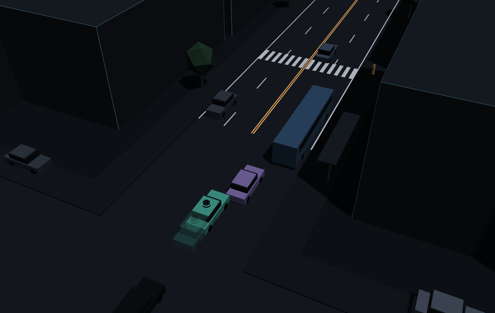
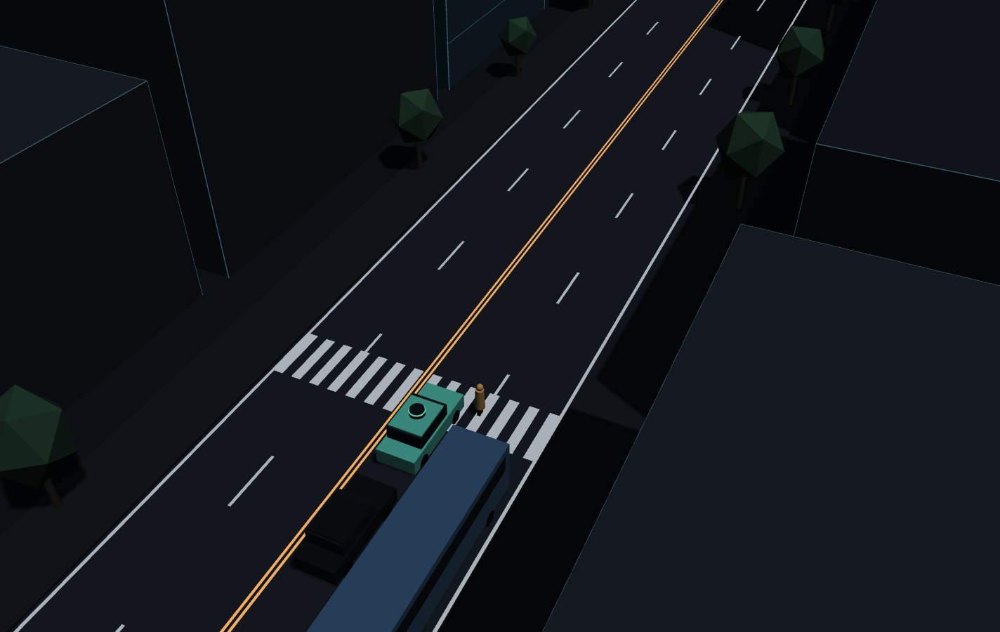
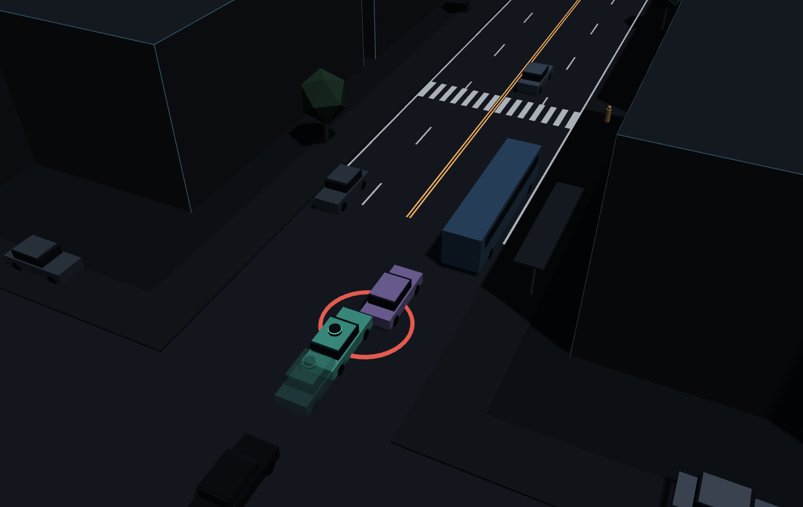
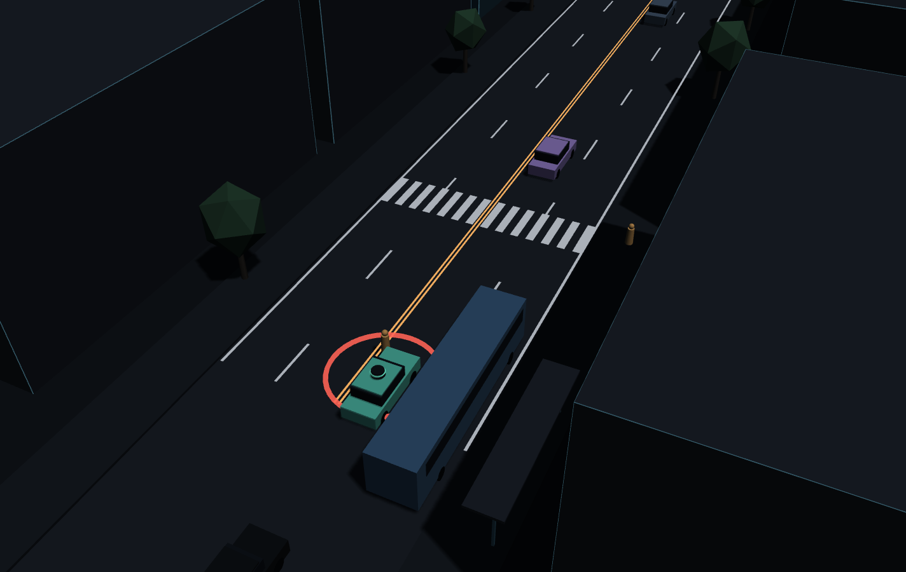

MSSV: 2A202602757

# Lab 11 · Scenario Forge — báo cáo

Thị trấn của bạn (`meta.json: _run.town`): **C** (cut_gap_median = 10 m: xe nhập làn bạo hơn; `pedLook` = 0,80: ít người ngó qua xe buýt hơn). Mọi số dưới đây trích từ `evidence/` của lần chạy đầy đủ (không `--quick`).

## 1. Phát lại log có trung thực không? (bước A)

| `replay.json` | Số |
|---|---|
| `n` / `dropped_human_crash_logs` / `n_used` | 400 / 0 / 400 |
| Planner trên log phát lại (`replay.crashes`) | **111** (`rear` 93, `side` 18) |
| Planner trong thế giới phản ứng (`reactive.crashes`) | **0** |
| `crash_in_both` | 0 |

Không log nào bị bỏ (người lái IDM không tự gây va chạm trong 400 kịch bản này). 111 va chạm chỉ có khi phát lại, 0 khi thế giới phản ứng, và không kịch bản nào va chạm ở cả hai: toàn bộ là va chạm **giả** (`fake: true`).

Vì sao phần lớn là `rear`: planner thận trọng hơn người lái (giảm tốc sớm trước vạch bị xe buýt che, giữ khoảng cách `T` = 1,6 s so với 1,1 s của người). Trong log, xe phía sau (TG) chạy đúng quỹ đạo đã ghi, tức là bám theo **người lái** chứ không phải theo planner. Log không biết planner phanh sớm hơn, nên TG không phanh và tông vào đuôi xe ta. Ngoài đời TG sẽ phản ứng với xe ta (thế giới phản ứng: 0 va chạm), nên đó không phải lỗi của planner.

Ví dụ `replay_only[0]` (kịch bản 2, `contact: rear`, `tgT` = 0,70 s): từ t ≈ 9,5 s planner chạy chậm hơn người lái trong log hơn 1 m/s vì thận trọng gần vạch qua đường. Ở t = 17,1 s (x ≈ 111 m), xe ta còn 1,18 m/s thì TG, phát lại theo log với 2,23 m/s, tông vào đuôi. Trong log người lái đã dừng hẳn ở chỗ khác nên TG không cần phanh. Trong thế giới phản ứng, TTC nhỏ nhất của cùng kịch bản là 2,37 s (`min_ttc_reactive`): không va chạm.

## 2. Kịch bản bất khả thi (bước B)

| Luật trong `is_feasible` | Căn cứ vật lý |
|---|---|
| Chuyển làn 3,5 m kiểu cosin trong `cutDur` giây có gia tốc ngang đỉnh (π/cutDur)²·3,5/2; loại nếu > μ·g | Lực ngang lớn nhất lốp truyền được là μ·m·g; vượt mức đó thì xe trượt, không thể chuyển làn như vậy. |
| `cutBrake` > μ·g thì loại | Gia tốc phanh không thể vượt ma sát lốp–đường (μ = 0,8 khô, 0,5 ướt). |
| `pedV` > 2,5 m/s thì loại | Tốc độ đi bộ băng đường thường ~1,2–1,5 m/s; trên 2,5 m/s là chạy, không phải người đi bộ của mô hình. |
| `cutV` ngoài (0, 22] m/s thì loại | Xe chuyển làn phải đang chạy, và 22 m/s (~80 km/h) đã vượt xa giới hạn tốc độ của phố nội thành này. |

`hunt.json: infeasible`: `bus_bypass` 2, `cut_in` 4, `crosswalk_block` 8, **`rear_ended` 13** (nhiều nhất). `mc.json: infeasible` = 19 / 3 000 dưới phân phối tự nhiên.

CEM bị kéo về vùng bất khả thi vì những kịch bản đó "nguy hiểm" nhất theo điểm số. Để xe ta bị tông đuôi, xe ta phải phanh gấp, và cách dễ nhất (theo điểm số) thường là xe nhập làn cắt cực gắt (`cutDur` rất ngắn) hoặc phanh mạnh hơn μ·g ngay sau khi vào làn, nhất là trên đường ướt. Điểm nguy hiểm không biết vật lý, nên đề xuất q trượt về phía đó.

Nếu **đếm** chúng là va chạm, ước lượng bị thổi phồng bởi những tai nạn không thể xảy ra. Tệ hơn, với importance sampling, các mẫu này nằm ở đuôi của p nên có trọng số lớn, và vài mẫu bất khả thi có thể chi phối cả con số. Cuộc săn cũng sẽ "thành công" ở một chỗ vô nghĩa thay vì tìm thất bại thật của planner.

## 3. Monte Carlo cho bạn biết gì (bước C1)

`mc.json`: k = **12**, n = **3 000**, p̂ = **4,00·10⁻³**, Wilson 95 % = **[2,29·10⁻³; 6,98·10⁻³]**. Cả 12 va chạm đều là `bus_bypass` (`mc.json: modes`).

Muốn khoảng tin cậy còn ±20 % của p: 1,96·√((1−p)/(n·p)) = 0,2 ⇒ n ≈ 96·(1−p)/p ≈ 96/0,004 ≈ **24 000** lần chạy, gấp 8 lần ngân sách hiện tại.

Các kiểu **chưa hề xuất hiện** trong 3 000 lần: `cut_in`, `crosswalk_block`, `rear_ended` và `other` (k = 0). Không báo 0 cho các kiểu này. Con số đúng là cận trên Wilson: P < **1,28·10⁻³** (`mc.json: per_mode.<kiểu>.hi` = 0,0012789), tương đương luật số 3 (3/3 000 = 1,0·10⁻³).

## 4. Importance sampling, ESS và độ suy biến (bước C3)

`estimate.json` (mỗi seed n = 600 mẫu cho mỗi kiểu):

| Seed | Kiểu | p | hits | ess | top_share |
|---|---|---|---|---|---|
| 0 | bus_bypass | 1,07·10⁻³ | 31 | 125 | 0,211 |
| 0 | cut_in | 0 → cận trên `upper_zero_hits` **2,5·10⁻²** | 0 | 138 | 0 |
| 0 | crosswalk_block | 6,65·10⁻⁷ | 53 | 140 | 0,497 |
| 0 | rear_ended | 0 → cận trên **2,5·10⁻²** | 0 | 115 | 0 |
| 1 | bus_bypass | 4,03·10⁻⁴ | 22 | 138 | 0,461 |
| 1 | cut_in | 0 → cận trên **2,5·10⁻²** | 0 | 128 | 0 |
| 1 | crosswalk_block | 2,01·10⁻⁷ | 62 | 127 | 0,231 |
| 1 | rear_ended | 0 → cận trên **2,5·10⁻²** | 0 | 122 | 0 |
| 2 | bus_bypass | 5,86·10⁻⁴ | 37 | 155 | 0,136 |
| 2 | cut_in | 0 → cận trên **2,5·10⁻²** | 0 | 136 | 0 |
| 2 | crosswalk_block | 1,82·10⁻⁷ | 52 | 138 | 0,238 |
| 2 | rear_ended | 0 → cận trên **2,5·10⁻²** | 0 | 123 | 0 |

Tổng (`total`): seed 0 = 1,07·10⁻³ [4,0·10⁻⁴; 3,0·10⁻³], seed 1 = 4,03·10⁻⁴ [1,6·10⁻⁵; 2,1·10⁻³], seed 2 = 5,87·10⁻⁴ [3,1·10⁻⁴; 2,1·10⁻³]. Trung vị ≈ 5,9·10⁻⁴.

**Các seed có đồng ý không?** Với `bus_bypass`, ba seed chênh nhau khoảng 2,7 lần (4,0·10⁻⁴ đến 1,07·10⁻³). Với `crosswalk_block`, chênh khoảng 3,7 lần (1,8·10⁻⁷ đến 6,7·10⁻⁷). Cùng bậc, nhưng không khớp nhau trong khoảng ±1,96·se.

**Có đồng ý với Monte Carlo không?** Không hẳn. MC cho `bus_bypass` 4,0·10⁻³ [2,29·10⁻³; 6,98·10⁻³], còn IS cho 4·10⁻⁴ đến 1,1·10⁻³: thấp hơn 4–10 lần và nằm ngoài khoảng Wilson của MC. Đây đúng là cái bẫy README đã nêu: cuộc săn `bus_bypass` co lại rất hẹp (`hunt.json: bus_bypass.stopped_tightening = true`, level đạt 0 từ vòng `it` = 3), q phủ thiếu một phần vùng va chạm thật, nên IS bị chệch thấp ở ngân sách này. Với `crosswalk_block`, IS cho cỡ 10⁻⁷, phù hợp với việc MC không thấy vụ nào (cận trên 1,28·10⁻³), nhưng cũng có thể là dấu hiệu cuộc săn tìm được một cách va chạm "dễ" nhưng rất hiếm chứ không phải cách hay xảy ra nhất.

**`top_share` lớn:** không ô nào vượt 0,5. Gần nhất là `crosswalk_block` seed 0 (0,497) và `bus_bypass` seed 1 (0,461): gần một nửa ước lượng do **một** mẫu nặng nhất mang. Khi đó con số chủ yếu là trọng số p/q của mẫu đó: có nó thì ước lượng gấp đôi, thiếu nó thì giảm một nửa, nên khoảng ±1,96·se có thể hẹp sai. Ngược lại, `top_share` thấp (0,136 ở seed 2) không chứng minh ước lượng đúng: nếu q bỏ sót hẳn một vùng va chạm thì không có mẫu nào nặng ký cả.

**Ngân sách:** `estimate.json: budget` = **16 800** lần chạy cho cả cuộc săn lẫn ước lượng. Để MC đạt cùng sai số tương đối (se/p) như IS:
- `bus_bypass` (se/p ≈ 0,24–0,49) cần khoảng 9 000–29 000 lần chạy MC: IS hơn MC chưa đáng kể, vì p ở đây không quá hiếm.
- `crosswalk_block` (p ≈ 2·10⁻⁷, se/p ≈ 0,3–0,6) cần khoảng **4·10⁶ đến 6·10⁷** lần chạy MC: IS rẻ hơn 2–3 bậc.

**Phần `other`** lấy từ Monte Carlo (`estimate.json: other` = k 0, n 3 000, p 0, hi 1,28·10⁻³, `source: mc.json`). Không săn `other` vì nó không có điểm nguy hiểm riêng: "va chạm không thuộc kiểu nào" không có một đại lượng liên tục để CEM leo dốc. Vì vậy phần của nó được báo bằng cận trên MC chứ không phải 0.

## 5. Các kiểu thất bại (bước C2 + 3D)

`hunt.json: found`: cuộc săn `bus_bypass` tìm được {`bus_bypass`: 120}, cuộc săn `crosswalk_block` tìm được {`crosswalk_block`: 32}. Cuộc săn `cut_in` chỉ ra {`bus_bypass`: 28}; cuộc săn `rear_ended` ra {`bus_bypass`: 31, `crosswalk_block`: 9}.

**`bus_bypass`** (chương 9, kịch bản B-01, t = 12,6 s) — 
Xe buýt đỗ ở trạm trong làn E2 (x ≈ 106 m). C2 kẹt sau xe buýt, chấp nhận một khe nhỏ (`cutGap` 7,35 m, đường ướt μ = 0,5) để lách sang làn E1 của xe ta, rồi gần như đứng lại khi còn nằm chéo giữa hai làn (z ≈ 3,2 m, v ≈ 0,5 m/s) đúng lúc xe buýt vừa rời trạm (`busGo` 12,17 s). Xe ta đang chạy chậm (3,8 m/s) vì thận trọng gần vạch bị che, nhưng không coi C2 nằm chéo làn là xe phía trước kịp, và đâm vào C2 (`contact: front`, t = 12,6 s).

**`crosswalk_block`** (chương 9, kịch bản C-02, t = 22,2 s) — 
Người đi bộ P1 đứng sau xe buýt ở vạch qua đường x = 122 m và không ngó qua xe buýt (`pedLook` = 0). Planner không thấy P1 cho đến khi người đã bước ra, phanh quá muộn trên đường ướt (μ = 0,5), và dừng hẳn với đầu xe nằm trên vạch (xe ta x ≈ 119,7 m, v = 0, t = 22,2 s). P1 không bước vào thân xe nên đứng lại giữa đường: sự kiện `kind: block`.

**Kiểu không tìm thấy:** `cut_in` và `rear_ended`. Cả hai cuộc săn đều chạy đủ 8 vòng mà không ra một va chạm đúng kiểu nào; Monte Carlo cũng không thấy (`mc.json: per_mode.cut_in.k` = 0, `rear_ended.k` = 0). Mức tin: chỉ dám nói chúng **hiếm hơn** khoảng 10⁻³ (cận trên MC 1,28·10⁻³), không nói được là không có. CEM với điểm nguy hiểm hiện tại có thể đơn giản là không leo tới vùng đó.

**Nếu chỉ chạy một cuộc săn chung:** cuộc săn sẽ co về kiểu dễ nhất, tức `bus_bypass`. Bằng chứng là chính các cuộc săn `cut_in` và `rear_ended`: dù điểm nguy hiểm nhắm vào kiểu khác, chúng vẫn trôi về `bus_bypass` (28 và 31 vụ). Một cuộc săn chung sẽ báo gần như toàn `bus_bypass` và bỏ mất `crosswalk_block`, một kiểu hiếm (~10⁻⁷) mà chỉ cuộc săn riêng mới tìm được 32 vụ.

## 6. Sửa planner (bước E + 3D)

Policy được chọn (`fix.json: chosen.policy`): **`cutinLat` = 2,6** (gốc 2,15): coi một xe đang lấn sang là xe phía trước sớm hơn, khi nó còn cách 2,6 m theo chiều ngang.

| `fix.json` | fail | fail_hi_seen | fail_hi (95 %, hợp lệ) | Quãng đường (m) | Phanh gấp (khung) |
|---|---|---|---|---|---|
| Bản sửa, **TRAIN** (`chosen`) | 1,12·10⁻⁶ | 2,55·10⁻⁶ | 2,55·10⁻⁶ (`unseen`: `bus_bypass`) | 210,32 | 7,93 |
| Policy gốc, TRAIN (`baseline_train`) | 3,29·10⁻⁴ | 6,00·10⁻⁴ | 6,00·10⁻⁴ | 210,26 | 8,98 |
| Bản sửa, **TEST** (`chosen_test`) | **3,44·10⁻⁴** | **8,18·10⁻⁴** | **2,10·10⁻³** | 209,19 | 8,66 |
| Policy gốc, **TEST** (`baseline_test`) | 9,76·10⁻⁴ | 1,87·10⁻³ | 3,15·10⁻³ | 209,24 | 8,99 |

TRAIN chỉ dùng để sàng. Trên TRAIN, bản sửa có 0 vụ `bus_bypass` (`unseen`), nên `fail_hi` trông như 2,55·10⁻⁶: đây chính là cái bẫy README nêu, vì mẫu TRAIN được rút ở nơi policy gốc thất bại. Trên TEST (seed mới, cuộc săn mới nhắm vào chính bản sửa), `bus_bypass` xuất hiện lại (4 hits), nhưng thất bại vẫn giảm khoảng 2,8 lần (3,44·10⁻⁴ so với 9,76·10⁻⁴), quãng đường gần như không đổi (209,19 m so với 209,24 m, mất 0,02 %), và số khung phanh gấp giảm nhẹ.

**Vì sao `fail_hi` của bản sửa (2,10·10⁻³) lớn hơn `fail` của policy gốc (9,76·10⁻⁴)?** `fail_hi` là cận trên, không phải ước lượng. Nó cộng thêm ±1,96·se của IS (với `top_share` 0,60 và 0,87 thì se lớn) và cận trên Wilson 1,28·10⁻³ của các va chạm khác (`other_crashes`: k = 0 trên n = 3 000). Phần bất định đó lớn hơn cả bản thân xác suất, nên so cận trên của bản sửa với điểm ước lượng của bản gốc là so khập khiễng. So đúng là cận với cận (2,10·10⁻³ < 3,15·10⁻³) hoặc ước lượng với ước lượng.

Ảnh chương 9, kịch bản B-02 (`bus_bypass`, t = 12,8 s): xe đặc chạy policy gốc và đâm C2 (vòng đỏ); bóng mờ là bản sửa `cutinLat` 2,6 trên cùng kịch bản, coi C2 đang lấn sang là xe phía trước sớm hơn nên dừng lại phía sau, không va chạm. 

**Núm "nghe thì an toàn hơn" nhưng phản tác dụng** (`fix.json: table`, trên TRAIN):
- **`T` = 2,0** (giữ khoảng cách lớn hơn 1,6 s): `crosswalk_block` tăng từ 1,12·10⁻⁶ lên **4,89·10⁻⁶** (gấp 4,4 lần, hits 38 lên 65). Thế giới phản ứng lại khoảng trống phía trước xe ta: người đi bộ quyết định băng khi xe gần nhất họ thấy còn đủ xa, và xe nhập làn chấp nhận khe vừa đủ (thị trấn C có trung vị `cutGap` chỉ 10 m). Khoảng trống lớn hơn mời họ đi vào, nên xe ta phải dừng gấp hơn và hay dừng với thân xe trên vạch.
- **`cautionV` = 6,0** (chậm hơn gần vạch bị che): `bus_bypass` tăng từ 3,28·10⁻⁴ lên **6,56·10⁻⁴**, trong khi 6,5 và 5,0 lại giảm. Bò chậm hơn khiến xe ta nằm cạnh xe buýt lâu hơn, đúng lúc C2 tìm khe để lách qua: C2 thấy một khe đủ lớn trước mũi xe ta và chen vào. An toàn không đơn điệu theo tốc độ.

## 7. Từ mô phỏng ra đường thật

| Giả định trong `space.py` | Dữ liệu thật thay thế | Nếu sai thì con số sai theo hướng nào |
|---|---|---|
| `pedLook` = 0,80 ở thị trấn C: 80 % người đi bộ ngó qua xe buýt trước khi băng | Video quan sát tại trạm xe buýt có vạch qua đường (camera giao lộ của thành phố, hoặc dataset như inD / nuScenes), đếm tỉ lệ người dừng nhìn trước khi bước ra sau xe buýt | Nếu người thật ngó ít hơn, `crosswalk_block` và va chạm với người đi bộ bị **ước lượng thấp**. |
| `cutGap` log-normal, trung vị 10 m: khe xe nhập làn chấp nhận | Quỹ đạo nhập làn trong dataset có nhãn (highD, exiD, NGSIM), lấy phân phối khe chấp nhận ở tốc độ phố nội thành | Khe thật nhỏ hơn (giao thông xe máy, xe buýt chen ở Việt Nam) thì `cut_in` và `bus_bypass` bị **ước lượng thấp**; khe lớn hơn thì ngược lại. |
| `wet` = 0,20 và μ = 0,5 khi ướt, 0,8 khi khô | Số ngày mưa theo giờ từ trạm khí tượng nơi xe chạy (vd. dữ liệu khí tượng thủy văn), cộng đo hệ số ma sát mặt đường thật (thiết bị đo μ, hoặc dữ liệu ABS / phanh của đội xe) | Ở vùng mưa nhiều hoặc đường trơn hơn 0,5, mọi kiểu cần phanh (`rear_ended`, `crosswalk_block`) bị **ước lượng thấp**. |

## 8. Giới hạn

1. **Một con phố, một trạm xe buýt, một vạch qua đường.** Xác suất `bus_bypass` 4·10⁻³ là "mỗi lần đi qua đúng đoạn phố này", không phải mỗi km hay mỗi chuyến. Không có giao lộ có đèn, vòng xoay hay xe máy, là phần lớn rủi ro thật ở đô thị Việt Nam.
2. **Mọi người khác đều là IDM với gap acceptance.** Không có ai vượt đèn, đi ngược chiều hay mất tập trung, nên đuôi phân phối "người cư xử tệ" bị cắt cụt: các kiểu thất bại nằm ngoài mô hình hành vi này có xác suất bằng 0 trong mô phỏng.
3. **Cảm biến hoàn hảo trừ phần bị xe buýt che.** Không nhiễu, không trễ, không nhận nhầm, không mưa làm giảm tầm nhìn; ma sát chỉ có hai mức 0,5 và 0,8. Các con số là cận dưới của rủi ro khi cảm nhận thật không hoàn hảo.

Nếu có thêm một tuần: (a) chạy MC lớn hơn (~25 000 lần) cho `bus_bypass` để kiểm tra độ chệch thấp của IS thấy ở câu 4; (b) thêm nhiễu và trễ cảm biến, rồi đo lại `crosswalk_block`; (c) săn với nhiều đề xuất khởi tạo khác nhau để xem cuộc săn có bỏ sót vùng va chạm nào không.

## 9. Rắc rối của bạn (bước G + chương 10)

- **Rắc rối:** một người đi bộ (H0, `type: ped`, `side: N`) băng ngang **ngoài vạch** ngay quanh đầu xe buýt đang đỗ ở trạm (x 100–118 m; vạch qua đường ở x = 80 m), xuất phát từ vỉa hè phía bên kia đường. Ngoài đời: hành khách chạy băng qua đường giữa khối nhà để kịp chuyến xe buýt đang đỗ.
- **Căn cứ:** planner chỉ có logic thận trọng gắn với vạch qua đường (`cautionV`, `cautionRange`, `pedBuffer` cho P1). Một người băng ngang chỗ không có vạch, gần xe buýt, nằm ngoài các tình huống planner được chỉnh cho.
- **Giả định** (`hazard.json: why`): `space` = {`h0_x`: [100, 118], `h0_v`: [1,2; 2,5] m/s (từ đi bình thường đến chạy chậm), `h0_trig`: [12; 35] m (dưới 12 m đã ngang quãng phanh ≈ 9 m ở 12 m/s nên không ai tránh nổi; trên 35 m ai cũng kịp)}. `exposure` = **0,02 mỗi chuyến**: giả định một chuyến qua ~4 trạm có xe buýt đỗ, mỗi lần ~0,5 % có người băng ngang trong cửa sổ đó. Đây là ước lượng của tôi, cần thay bằng tần suất đếm từ video camera tại trạm xe buýt.
- **Kết quả** (`mine.json`, 1 500 lần rút, `accepted` = **99,7 %**, 1 495 khả thi; cảnh gốc `exact`: planner đâm H0 ở t = 15,75 s):

| `mine.json` | Policy gốc (`baseline`) | Bản sửa `cutinLat` 2,6 (`chosen`) |
|---|---|---|
| Va chạm của xe ta | 24 | 24 |
| `avoidable` (tránh được bằng phanh hết cỡ ngay khi thấy) | **21** | **23** |
| `avoidable_foreknown` | 21 | 23 |
| `unavoidable` | 0 | 0 |
| `unattributed` | 3 | 1 |
| `low_speed` (< 1 m/s) | 2 | 1 |
| P(lỗi planner \| rắc rối), Wilson 95 % | **1,40·10⁻²** [9,21·10⁻³; 2,14·10⁻²] | 1,54·10⁻² [1,03·10⁻²; 2,30·10⁻²] |
| × exposure 0,02 = tần suất mỗi chuyến | **2,81·10⁻⁴** (cận trên 4,28·10⁻⁴) | 3,08·10⁻⁴ (cận trên 4,60·10⁻⁴) |

  Đặt cạnh tần suất lách xe buýt: `mc.json` cho `bus_bypass` 4,0·10⁻³ [2,29·10⁻³; 6,98·10⁻³] mỗi lần qua đoạn phố (IS cho thấp hơn, trung vị ≈ 5,9·10⁻⁴). Rắc rối của tôi ở mức 2,8·10⁻⁴ mỗi chuyến: hiếm hơn `bus_bypass` theo MC khoảng 14 lần, nhưng cùng bậc với ước lượng IS. Con số này phụ thuộc hoàn toàn vào `exposure` mà tôi giả định.

  **Bản sửa ở bước E không cứu được:** 23 vụ `avoidable` so với 21, và hai khoảng Wilson chồng lên nhau gần hết. `cutinLat` chỉ đổi cách planner coi xe đang lấn làn, không liên quan đến người đi bộ.

  **Ba loại va chạm:** chỉ `avoidable` tính là lỗi planner. `unattributed` (3 vụ ở policy gốc) là va chạm thường của thị trấn xảy ra trước khi H0 bắt đầu băng (ví dụ đâm C2 ở t = 12,4 s), không nói gì về rắc rối. Không có vụ `unavoidable`, và `avoidable_foreknown` bằng `avoidable`: trong `space` này việc bị che tầm nhìn không phải nguyên nhân, vì người xuất phát từ phía bên kia đường nên xe buýt không che. Lỗi nằm ở phản ứng của planner. Trong các ví dụ của `mine.json`, xe ta đâm khi chỉ còn 1–5 m/s và khoảng 4 s sau khi H0 bắt đầu đi (`fire_t` → `t`): planner có giảm tốc nhưng không dừng hẳn cho người đang băng.

  **"Tránh được" là chuẩn lạc quan theo hai chiều:** (1) người phanh "thần" biết ngay đó là nguy hiểm từ khung hình đầu tiên nhìn thấy và phanh tối đa μ·g, không có thời gian nhận biết hay phản xạ, nên `avoidable` **đếm nhiều hơn** số vụ một planner thật tránh được (đây là cận trên của lỗi planner theo nghĩa này); (2) ngược lại, chỉ thử phanh mà không thử đánh lái, nên vài vụ tránh được bằng lách sẽ bị xếp vào `unavoidable` và **đếm ít đi**.

- **Hình:**  _(chương 9, kịch bản GB-01, t = 16,0 s: xe ta đi cạnh xe buýt đang đỗ và đâm người băng ngang từ phía bên kia đường, vòng đỏ)_
- **Bạn tự lái thì sao:** _(điền sau khi tự lái ở chương 10: bấm "Bạn", nhớ rằng bạn đã xem lại cảnh nhiều lần còn planner thì không)_
- **Cách sửa:** chạy thêm ngoài `evidence/` (600 lần rút cùng `space`, không nằm trong `mine.json`), số vụ `avoidable`: policy gốc 11; `pedBuffer` 3,5 hoặc 5,0 vẫn **11** (không đổi); `b` 3,0 ra 12; `T` 2,0 ra 8; `cautionRange` 120 m ra 7; `v0` 10 m/s ra 6. `pedBuffer` không có tác dụng vì biên an toàn đó chỉ áp cho người ở vạch qua đường; giảm tốc chung (`v0`, `cautionRange`) giảm khoảng một nửa nhưng làm mất quãng đường ở mọi nơi. Không núm nào sửa tận gốc, nên planner cần **logic mới**: theo dõi **mọi** người đi bộ đang ở trên lòng đường (không chỉ ở vạch), dự đoán quỹ đạo của họ, và nếu quỹ đạo cắt làn xe ta trong vài giây tới thì nhường đến khi người đó qua hẳn, thay vì chỉ giảm tốc. Thêm một vùng giảm tốc quanh trạm xe buýt khi có xe buýt đang đỗ, vì đó là nơi người hay chạy băng ngang.
